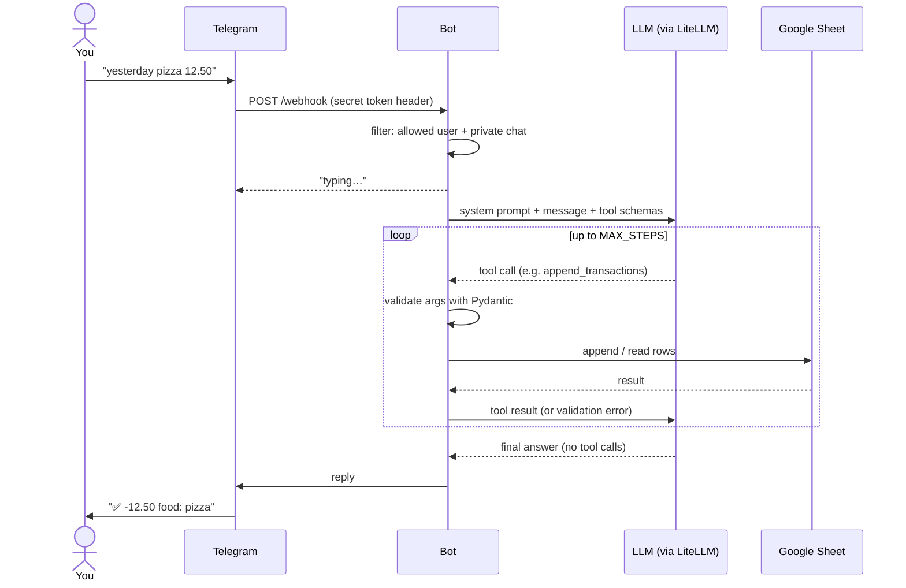

# cashflow-bot

A personal Telegram bot that tracks expenses and income in a Google Sheet.
You write in plain language ("coffee 1.20 and fuel 40", "how much did I spend this month?"),
an LLM turns the message into structured tool calls, and the bot reads or writes the sheet.

The bot is model-agnostic: it talks to the LLM through [LiteLLM](https://docs.litellm.ai/docs/providers),
so you can switch provider (Gemini, Claude, OpenAI, a local model, …) by changing `LLM_MODEL`
and the matching API key in `.env`, with no code changes. The model must support tool calling.

## How it works



1. **Receive.** Telegram sends each new message to the bot's webhook. Requests without the
   right secret token are rejected.
2. **Filter.** Only users listed in `TG_ALLOWED_IDS` are handled, and only in private chats.
   Everyone else is silently ignored.
3. **Ask the LLM.** The message is sent together with a system prompt (today's date and
   timezone, so "yesterday" can be resolved) and the JSON schemas of the available tools.
4. **Tool loop.** If the LLM asks for a tool, the bot validates the arguments with Pydantic
   (ISO date, known category and payment method), runs it against the sheet and sends the
   result back. Errors are sent back too, so the LLM can correct itself. The loop stops when
   the LLM answers without tool calls, or after `MAX_STEPS` iterations.
5. **Reply.** The final answer is sent back to the chat.

### Tools

| Tool | What it does |
|---|---|
| `append_transactions` | Records one or more expenses/income rows |
| `query_transactions` | Lists the transactions in a date range (max 50), optionally by category |
| `sum_transactions` | Sums the amounts in a date range, optionally by category |

Totals are always computed by `sum_transactions`, never by the LLM.

## Google Sheet layout

The table lives in columns **B–F** with the header in row **1**:

| B | C | D | E | F |
|---|---|---|---|---|
| date | payment method | category | description | amount |

Allowed values for `category` and `payment method` are configured via `CATEGORIES` and
`PAYMENT_METHODS` in `.env` (`PAYMENT_METHODS` must include `Contanti`, used as default when
none is specified).

To use a different range, change `FIRST_COL`, `LAST_COL` and `HEADER_ROW` in `src/sheet.py`.

Share the sheet with the service account's email address (Editor access).

## Running locally

Copy `.env.example` to `.env` and fill in the values (each variable is described there).

Locally the bot uses **polling** (no public URL needed):

```bash
cp .env.example .env   # then fill in .env
uv sync
uv run python src/main.py poll
```

Or with Docker:

```bash
docker build -t cashflow-bot .
docker run --rm --env-file .env cashflow-bot python src/main.py poll
```

## Development

Run linter, type checker and tests:

```bash
uv run ruff check .
uv run ruff format --check .
uv run mypy src
uv run pytest
```

